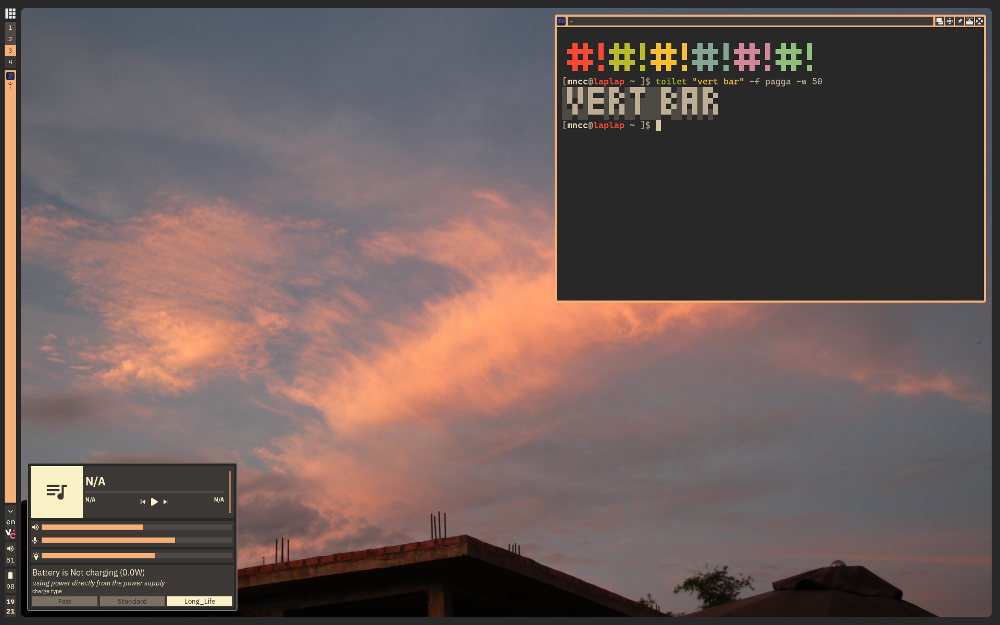

# somewm configs
my somewm configs, adapted from the old awesomewm config



wallpapers are not included. though you can find them on [my main repo](https://github.com/mncc8337/.dotfiles). should be on `./wallpaper`

## a few notes
- module `signal/backlight.lua`, `signal/battery.lua`, `signal/ideapad.lua` need some udev configs. see `assets/udev/`
- if using the `theme.colorscheme.dynamic` theme, you need to uncomment this line on `rc.lua` and run it once to actually build the gtk theme
```lua
-- run this after changing theme
-- theme.build_gtk_theme()
```
- wallpapers are loaded from "$DOTFILES/wallpaper/" by default, change it on `theme/init.lua`
- missings file refs can be found on [the main dotfiles repo](https://github.com/mncc8337/.dotfiles), it is because this configs originally lives in `.config/awesome` of that repo and had been splitted to be a separated repo

### changes compared to the awm branch
- built in lockscreen configs
- slider are not yet working (they causing crashes when reloading)
- `signal/screenshot.lua` now uses the `screenshot` script in the dotfiles repo.
- added input devices config `config/input.lua`, `signal/touchpad.lua` is now obsolete (until i figure out a way to refactor)

## dependecies
this config needs: (optional are marked with (*))
- [somewm-git](https://github.com/trip-zip/somewm) obviously
- [zsh](https://www.zsh.org/) (*), shell
- [nemo](https://github.com/linuxmint/nemo/) (*), GUI file explorer
- [tym](https://github.com/endaaman/tym) (*), terminal emulator
- [rofi](https://github.com/davatorium/rofi) (*), app launcher
- [playerctl](https://github.com/altdesktop/playerctl) (*), control mpris2 based media, needed for `signal/playerctl.lua` module
- [themix-theme-oomox](https://github.com/themix-project/oomox-gtk-theme) (*), dynamic theming, needed for the `theme.colorscheme.dynamic` theme
- libpulse (pulseaudio) or pipewire-pulse (pipewire) (*), for pactl, needed for `signal/pulseaudio.lua` module
- [grim](https://gitlab.freedesktop.org/emersion/grim) and [slurp](https://github.com/emersion/slurp) (*), for the `signal/screenshot.lua` module
- [wl-clipboard](https://github.com/bugaevc/wl-clipboard) (*), though kinda necessary for wayland
- these fonts are used by default (*)
    - cascadia-code-nerd
    - ibm-plex

```sh
yay -S somewm-git
yay -S zsh nemo tym rofi playerctl themix-theme-oomox-git pipewire-pulse grim slurp
yay -S ttf-cascadia-code-nerd ttf-ibm-plex bibata-cursor-theme
```
