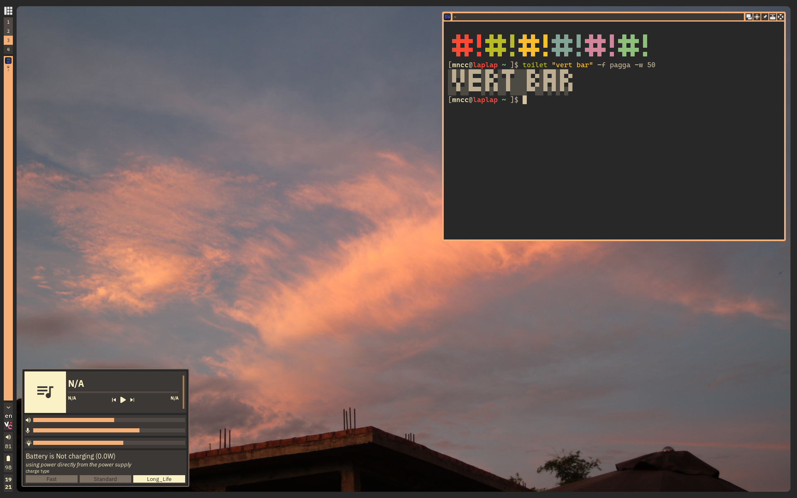
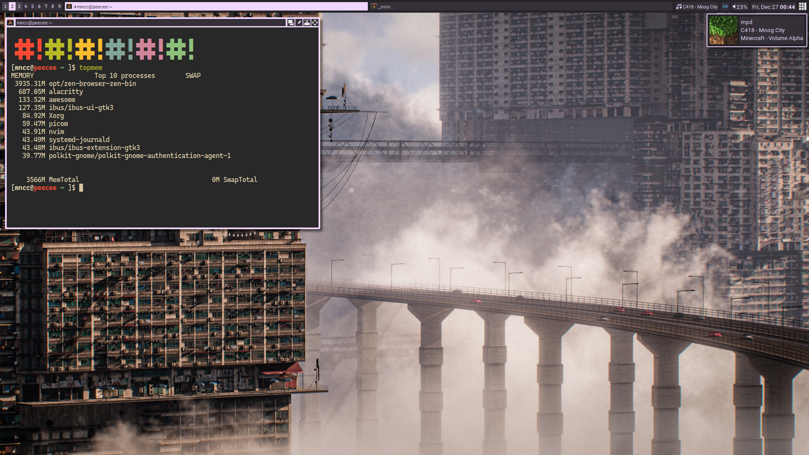

# dotfiles
my awesome wm configs

`vertical-bar` branch

`horizontal-bar` branch


## a few notes
- module `signal/backlight.lua`, `signal/battery.lua`, `signal/ideapad.lua` need some udev configs. see `assets/udev/`
- if using the `theme.colorscheme.dynamic` theme, you need to uncomment this line on `rc.lua` and run it once to actually build the gtk theme
```lua
-- run this after changing theme
-- theme.build_gtk_theme()
```
- wallpapers are loaded from "$DOTFILES/wallpaper/" by default, change it on `theme/init.lua`
- missings file refs can be found on [the main dotfiles repo](https://github.com/mncc8337/.dotfiles), it is because this configs originally lives in `.config/awesome` of that repo and had been splitted to be a separated repo

## dependecies
this config needs: (optional are marked with (*))
- [awesome](https://awesomewm.org/) obviously
- [zsh](https://www.zsh.org/) (*), shell
- [nemo](https://github.com/linuxmint/nemo/) (*), GUI file explorer
- [wezterm](https://wezterm.org/) (*), terminal emulator
- [rofi](https://github.com/davatorium/rofi) (*), app launcher
- xorg-xrandr for xrandr and [arandr](https://github.com/haad/arandr) (*)
- [playerctl](https://github.com/altdesktop/playerctl) (*), control mpris2 based media, needed for `signal/playerctl.lua` module
- [themix-theme-oomox](https://github.com/themix-project/oomox-gtk-theme) (*), dynamic theming, needed for the `theme.colorscheme.dynamic` theme
- [snixembed](https://git.sr.ht/~steef/snixembed/) (*), for displaying `StatusNotifierItem` systray protocol because awesome does not support it
- libpulse (pulseaudio) or pipewire-pulse (pipewire) (*), for pactl, needed for `signal/pulseaudio.lua` module
- xorg-xinput for `xinput` (*), needed for `signal/touchpad.lua` module
- [picom](https://github.com/yshui/picom) (*)
- [maim](https://github.com/naelstrof/maim) and [slop](https://github.com/naelstrof/slop) (already comes with main iirc) (*), for the `signal/screenshot.lua` module
- [i3lock-color](https://github.com/Raymo111/i3lock-color) and [xidlehook](https://gitlab.com/jD91mZM2/xidlehook) (*), used in the lock command in `rc.lua`
- [xclip](https://github.com/astrand/xclip) (*), though kinda necessary for X11
- these fonts are used by default (*)
    - cascadia-code-nerd
    - ibm-plex

```sh
yay -S zsh nemo wezterm rofi playerctl themix-theme-oomox-git pipewire-pulse main slop snixembed xorg-xinput xorg-xrandr arandr
yay -S ttf-cascadia-code-nerd ttf-ibm-plex bibata-cursor-theme
yay -S awesome-git xorg-xinput picom-git maim i3lock-color xidlehook xclip
```
